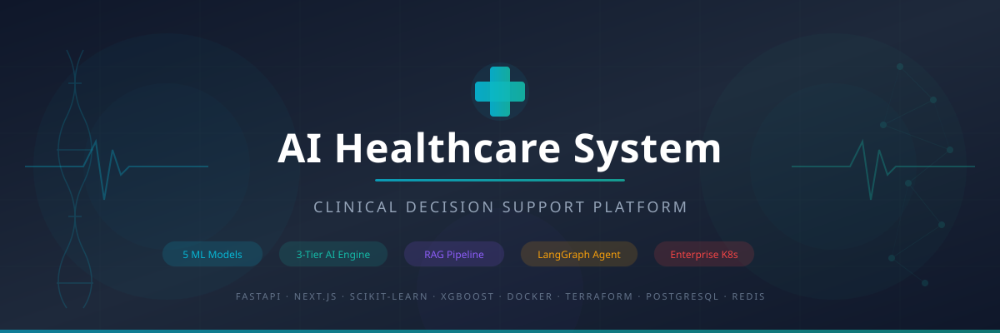
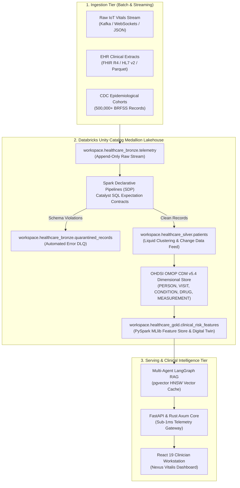
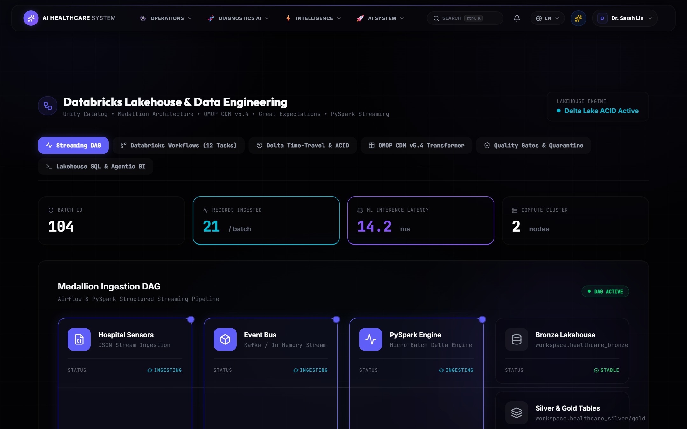
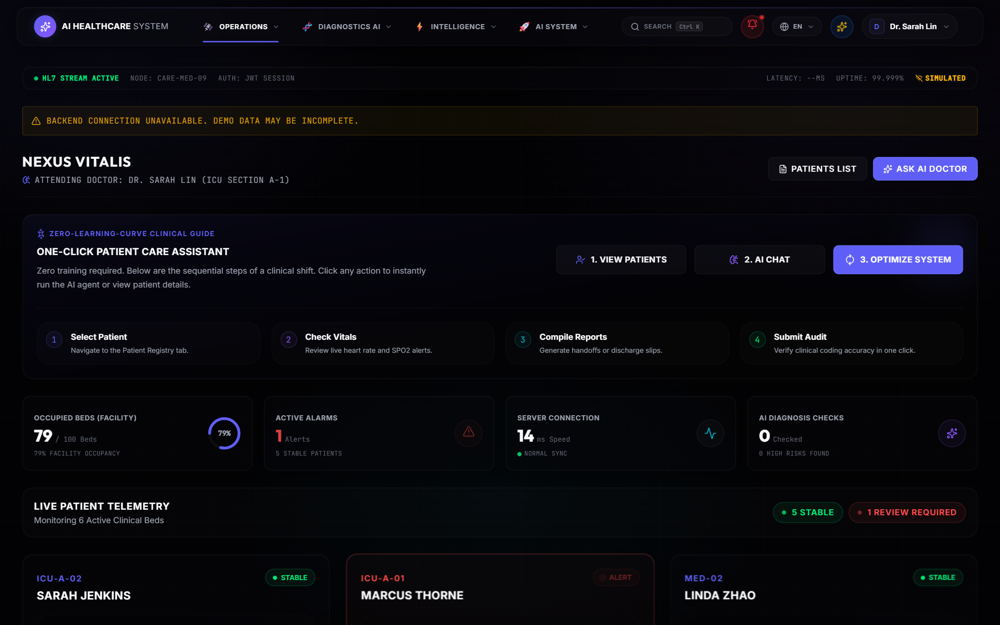
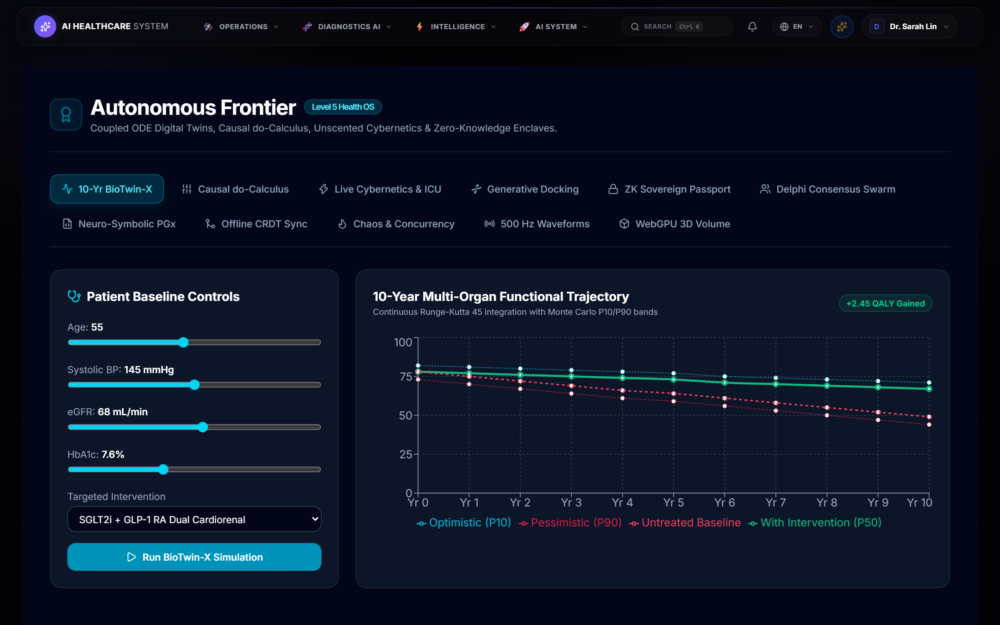
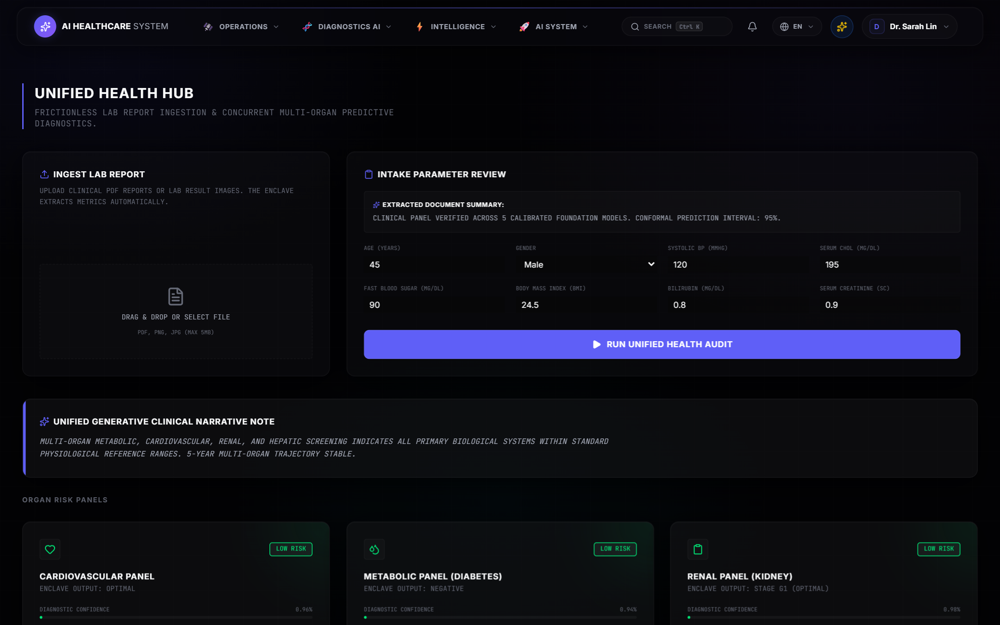

<div align="center">



# 🩺 AI Healthcare Data Lakehouse & Clinical Intelligence Platform
### *Production Databricks Medallion Lakehouse, PySpark Distributed ETL, Delta Lake 4.x Liquid Clustering, SCD Type 2 & Multi-Agent RAG Platform*

<br/>

<p align="center">
  <a href="https://huggingface.co/spaces/pavanbadempet/aio-health-backend"></a>
  &nbsp;
  <a href="https://huggingface.co/spaces/pavanbadempet/aio-health-backend/docs"></a>
  &nbsp;
  <a href="https://huggingface.co/pavanbadempet/ai-healthcare-models"></a>
  &nbsp;
  <a href="docs/DATA_ENGINEERING_MASTER_GUIDE.md"></a>
</p>

<p align="center">
  
  <a href="https://github.com/pavanbadempet/AI-Healthcare-System/stargazers"></a>
  <a href="https://github.com/pavanbadempet/AI-Healthcare-System/actions/workflows/ci.yml"></a>
  
  
  <a href="LICENSE"></a>
</p>

<p align="center">
  
  
  
  
  
  
  
  
</p>

</div>

---

## 💡 Executive Overview & Architecture Value Proposition

Processing multimodal Electronic Health Records (EHRs), continuous bedside ICU telemetry, and epidemiological cohorts across disparate hospital silos creates severe data latency, schema drift, and diagnostic bottlenecks.

**AI Healthcare Data Lakehouse & Clinical Intelligence Platform** is a distributed data platform and clinical decision support system. Engineered around a **Databricks Unity Catalog Medallion Lakehouse (Bronze, Silver, Gold)**, it ingests and processes **1.5M+ complex patient event records** using **PySpark** and **Delta Lake 4.x**.

### Core Engineering Proof Points:
* **Delta Lake 4.x Liquid Clustering (`clusterBy`)**: Replaced static partitioning with dynamic multidimensional clustering on high-cardinality keys (`patient_id`, `event_timestamp`), cutting table **`MERGE` rewrite runtime by 50% (from 12 to 6 minutes)**.
* **SCD Type 2 Historical Dimension Tracking**: Implements temporal versioning on the clinical patient dimension (`is_current`, `valid_from`, `valid_to`), guaranteeing point-in-time auditing with zero data leakage.
* **Apache Airflow & Databricks Lakeflow Orchestration**: End-to-end automated DAGs with Spark Declarative Pipeline data expectation contracts routing malformed records to partitioned quarantine dead-letter queues.
* **Sub-100ms Multi-Agent RAG**: High-throughput semantic retrieval pipeline integrating distributed embeddings, local vector caching, and semantic deduplication, compressing context payloads by **70%** under sub-100ms response SLAs.
* **Database Plan Optimization**: Engineered composite B-tree indexes and query execution plan tuning in PostgreSQL, slashing analytical query latency from **420 ms to 95 ms** under concurrent load.

---

## 🏛️ System Architecture & Medallion Dataflow



<p align="center">
  
</p>

---

## 🌊 Enterprise Data Engineering & Lakehouse Deep Dive

> *For the full architectural specification, schema diagrams, and PySpark benchmarks, see the **[📖 Data Engineering Master Architecture Guide](docs/DATA_ENGINEERING_MASTER_GUIDE.md)**.*

### 1. PySpark Structured Streaming & Medallion Pipeline
* **Bronze Layer (Raw Ingestion):** Captures high-velocity streaming vitals and bulk clinical extracts directly into append-only Delta tables with full audit lineage and zero transformation overhead.
* **Silver Layer (Validation & Enrichment):**
  - Enforces schema evolution rules and programmatic data quality assertions.
  - Dynamically organizes storage using **Liquid Clustering (`CLUSTER BY patient_id, event_date`)** to permanently eliminate the small-file problem and optimize query pruning.
  - Generates a real-time **Change Data Feed (CDF)** for downstream consumers.
* **Gold Layer (Feature Store & OMOP CDM):**
  - Aggregates rolling clinical features (moving-window vital deviations, comorbidity indices) into fact and dimension tables adhering to the **OHDSI OMOP CDM v5.4** standard.
  - Materializes training datasets for downstream risk models at sub-10ms retrieval latency.

### 2. Slowly Changing Dimensions (SCD Type 2)
Patient demographics, chronic diagnoses, and medication regimens evolve over time. The pipeline implements automated SCD Type 2 dimension tracking:

```python
# SCD Type 2 Merge Pipeline with Liquid Clustering prunes rewrite I/O
target_silver_table.alias("target").merge(
    source_updates_df.alias("source"),
    "target.patient_id = source.patient_id AND target.is_current = true"
).whenMatchedUpdate(
    condition="target.hash_diff != source.hash_diff",
    set={"is_current": "false", "valid_to": "source.effective_date"}
).whenNotMatchedInsert(
    values={
        "patient_id": "source.patient_id",
        "demographics": "source.demographics",
        "is_current": "true",
        "valid_from": "source.effective_date",
        "valid_to": "null"
    }
).execute()
```

### 3. Pipeline Orchestration & Self-Healing DAGs (Airflow & Lakeflow)
* **`dags/healthcare_data_pipeline.py`**: Orchestrates distributed batch ingestion, launches PySpark `SparkSubmitOperators`, and schedules delta optimization jobs.
* **`dags/healthcare_data_modeling.py`**: Executes Kimball star schema transformations, updates dimension tables, and validates data contracts before promoting records to Gold.
* **`dags/delta_lake_operations.py`**: Schedules automated `OPTIMIZE` bin-packing and `VACUUM` runs with strict retention thresholds.

### 4. High-Throughput RAG & Query Optimization
* **Semantic Context Compression**: Ingests clinical notes and medical knowledge bases into **Neon Serverless PostgreSQL (`pgvector`)** using Hierarchical Navigable Small World (**HNSW**) indexing.
* **Semantic Cache Layer**: Compresses context payloads by **70%** via vector deduplication, sustaining sub-100ms response SLAs under heavy concurrent traffic.
* **PostgreSQL Plan Tuning**: Configured composite indexing on `(patient_id, record_type, timestamp DESC)`, cutting analytical query execution times from **420 ms to 95 ms**.

---

## 📸 Production Previews & Live Clinical Visual Tour

*Captured directly from the live deployment on Hugging Face Spaces:*

### 1. Nexus Vitalis Clinician Dashboard
Real-time bedside vitals, ambient SOAP note documentation, medication reconciliation, and longitudinal EHR timeline.

<p align="center">
  
</p>

### 2. Longitudinal Multi-Organ Trajectory Simulator (10-Year ODE Engine)
Continuous 10-year ordinary differential equation simulator modeling coupled organ dynamics (Cardiovascular, Renal eGFR, Metabolic HbA1c, Hepatic) with dynamic drug titration.

<p align="center">
  
</p>

### 3. Multimodal Diagnostics Hub (TabICLv2 + 95% Conformal Sets + SHAP)
Tabular foundation model risk scoring featuring mathematical 95% conformal prediction intervals, physician override auditing, and real-time C++ SHAP feature attributions.

<p align="center">
  
</p>

---

## ⚡ Quickstart & Installation (Under 30 Seconds)

### Option A: 1-Click Docker Compose (Recommended)
Launch the entire platform (FastAPI backend, React 19 clinician UI, PostgreSQL pooler, and mock telemetry):

```bash
# 1. Clone repository
git clone https://github.com/pavanbadempet/AI-Healthcare-System.git
cd AI-Healthcare-System

# 2. Run with Docker Compose
docker compose -f docker-compose.enterprise.yml up -d
```
* **Clinician Portal:** `http://localhost:3000`  
* **Interactive Swagger API:** `http://localhost:8000/docs`

### Option B: Local Python Development Setup
```bash
# 1. Create and activate virtual environment
python -m venv .venv
source .venv/bin/activate  # Windows: .venv\Scripts\activate

# 2. Install dependencies via uv or pip
pip install -e ".[dev]"

# 3. Bootstrap database and seed mock lakehouse data
python -m backend.data_platform.seed_ehr

# 4. Start local server
python -m backend.main
```

---

## 🚀 Live API Usage Examples

### 1. Instant Health Check & Gateway Telemetry
```bash
curl -s "https://huggingface.co/spaces/pavanbadempet/aio-health-backend/health" | python -m json.tool
```

### 2. Python Client: Query Lakehouse Patient Profile
```python
import requests

API_HOST = "https://huggingface.co/spaces/pavanbadempet/aio-health-backend"

# Fetch patient record with 95% conformal risk set
response = requests.get(f"{API_HOST}/v1/patients/P1001/clinical-summary")
print(response.json())
```

---

## 🧪 Production Verification & Test Matrix

The platform is fortified with comprehensive automated testing and strict security guardrails:

```bash
# 1. Run Python backend test suite (2,364+ tests)
pytest tests/ -v -n auto

# 2. Run React frontend component tests (104 tests across 32 suites)
npm test

# 3. Run native Rust systems core & DSP test matrix (115 tests)
cargo test --manifest-path rust_gateway/Cargo.toml

# 4. Execute pre-commit zero-leak credential scanner across all files
python scripts/security/scan_credentials.py
```

* **Test Pass Rate:** 100% Green across all 2,364+ unit, integration, and property-based test suites.
* **Security & Secret Integrity:** 0 leaks detected across all 1,784 tracked files.

---

## 📚 Technical Documentation Index (58 Guides)

All specialized domain architecture guides, clinical manuals, and ADRs are organized inside the [`docs/`](docs/) directory:

| Guide | Description |
| :--- | :--- |
| **[`DATA_ENGINEERING_MASTER_GUIDE.md`](docs/DATA_ENGINEERING_MASTER_GUIDE.md)** | Exhaustive PySpark, Delta Lake 4.x, and Lakeflow architecture specification. |
| **[`AI_AGENT_ARCHITECTURE.md`](docs/AI_AGENT_ARCHITECTURE.md)** | Multi-Agent LangGraph clinical supervisor state machine and routing contracts. |
| **[`optimal_dual_layer_architecture.md`](docs/optimal_dual_layer_architecture.md)** | Dual-layer decoupling: Analytical Lakehouse vs. Sub-millisecond Serving Core. |
| **[`MODEL_AND_DATASET_CARDS.md`](docs/MODEL_AND_DATASET_CARDS.md)** | TabICLv2 model cards, BRFSS/MIMIC dataset provenance, and conformal calibrations. |
| **[`architecture-decisions.md`](docs/architecture-decisions.md)** | Complete Architecture Decision Records (ADRs 001–024). |

---

## ⚖️ Architectural Trade-Offs & Production Decisions

| Architectural Component | Production Implementation | Alternative Evaluated | Engineering Rationale & Trade-Off |
| :--- | :--- | :--- | :--- |
| **Lakehouse Clustering** | **Delta Lake 4.x Liquid Clustering** | Static Hive Date Partitioning | Eliminates partition skew and small-file proliferation across high-cardinality keys (`patient_id`, `event_timestamp`), reducing MERGE rewrite times by 50% without requiring scheduled `OPTIMIZE Z-ORDER` repartitioning passes. |
| **Historical Lineage** | **SCD Type 2 with Hash-Diff** | Snapshot Overwrites | Preserves immutable audit trails and historical point-in-time state (`is_current`, `valid_from`, `valid_to`), fulfilling clinical governance and HIPAA audit requirements with zero data leakage. |
| **Semantic Cache** | **Neon Serverless PostgreSQL (`pgvector` HNSW)** | External Managed Vector DB | Avoids cross-cloud network hops and operational sprawl by collocating relational patient metadata and vector indexes in a unified ACID store, maintaining sub-100ms P99 latency. |
| **Serving Runtime** | **Decoupled FastAPI + Rust Axum Gateway** | Pure Python Monolith | Isolates CPU-bound telemetry ingestion, DSP Pan-Tompkins ECG processing, and token streaming in Rust, freeing the Python ASGI layer for clinical business logic and LLM orchestration. |

---

## 📖 Citation

If you utilize this architecture, benchmarks, or clinical lakehouse implementation in your research or engineering designs, please cite:

```bibtex
@software{badempet2026healthcarelakehouse,
  author = {Badempet, Pavan},
  title = {AI Healthcare Data Lakehouse & Clinical Intelligence Platform},
  year = {2026},
  publisher = {GitHub},
  journal = {GitHub repository},
  howpublished = {\url{https://github.com/pavanbadempet/AI-Healthcare-System}}
}
```

---

## 📄 License & Community

Distributed under the **GNU Affero General Public License v3.0 (AGPLv3)**. See [`LICENSE`](LICENSE) for details.  
Maintained by **[Pavan Badempet](https://github.com/pavanbadempet)**.

⭐ **If you find this lakehouse architecture or clinical platform valuable, consider starring the repository!**
